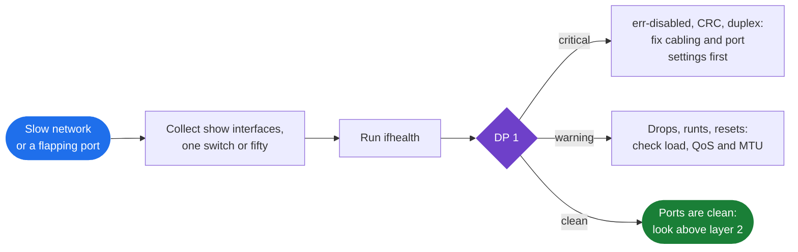

# cisco-interface-health

[](https://github.com/a-ayrapetov/cisco-interface-health/actions/workflows/ci.yml)

Offline triage of Cisco IOS / IOS-XE `show interfaces` output. Paste the output from one switch or fifty and get a ranked list of the ports that need attention, with the likely cause and the next step.

## When to run it



## What it flags

| Finding | Severity | Typical cause |
|---|---|---|
| err-disabled | critical | port security, BPDU guard, storm control, link flap |
| CRC errors above 0.01% of input | critical | bad cable, optic or patch panel |
| Half duplex while up, or late collisions | critical | duplex mismatch |
| Runts / giants | warning | duplex problem, faulty NIC, MTU mismatch |
| Output drops above 0.1% of output | warning | congestion, QoS, microbursts |
| More than 10 interface resets | warning | flapping link |

Thresholds are at the top of `ifhealth.py`.

## Safety

Pure text parsing with the Python standard library. It never connects to a device, so it is safe to run on output a client hands you.

## Install

```bash
pip install git+https://github.com/a-ayrapetov/cisco-interface-health
```

This installs an `ifhealth` command. You can also run `python ifhealth.py` straight from a clone.

## Usage

```bash
python ifhealth.py show_interfaces.txt
python ifhealth.py show_interfaces.txt --csv findings.csv
cat show_interfaces.txt | python ifhealth.py -
```

Exit codes: `0` clean, `1` findings, `2` error.

Example against the included sample:

```
Parsed 6 interfaces, 5 findings.
[CRITICAL] GigabitEthernet1/0/2   CRC errors: 4521 CRC (4.5210% of input)
[CRITICAL] GigabitEthernet1/0/3   Duplex mismatch likely: Half-duplex, 87 late collisions
[CRITICAL] GigabitEthernet1/0/4   err-disabled: err-disabled
[WARNING ] GigabitEthernet1/0/3   Runts/giants: 312 runts, 0 giants
[WARNING ] GigabitEthernet1/0/4   Interface resets: 45 resets
```

## Tests

```bash
pip install pytest && python -m pytest
```

## License

MIT. See LICENSE. Security reports: see SECURITY.md.

